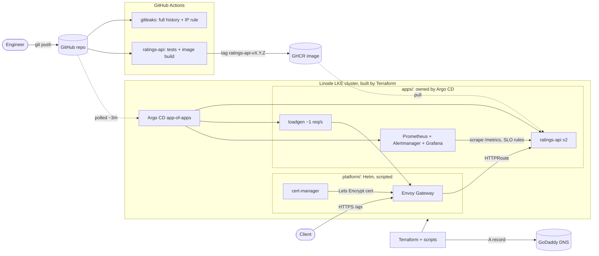

# Agent Ratings Platform

A Rotten Tomatoes–style rating site for AI agent companies, built as a **Kubernetes platform engineering portfolio project**.

The application is intentionally simple. Roughly 90% of the effort goes into the platform underneath it: cluster provisioning, GitOps delivery, security, and observability with SLOs, all built the way I would build them for a production team. Every claim below has a measured number or a drill behind it, and the cluster is rebuilt from scratch and torn down each session.

## Architecture



Two layers, on purpose. Terraform and four scripts build the cluster and its platform (Gateway, cert-manager, DNS, Argo CD). From then on, Git is the only way anything changes: Argo CD syncs `apps/`, reverts manual edits, and prunes what is deleted. Moving `platform/` under Argo too is the next planned step (see Known gaps).

## Measured results

All from real runs on 2026-10-14 unless noted. Raw data in `results/*.csv`; method and exclusions in [docs/RUNBOOK.md](docs/RUNBOOK.md#metrics-resultscsv-recorded-with-record1).

| What | Result | n |
|---|---|---|
| Cluster ready (terraform apply → all nodes Ready) | 179–208s | 7 |
| Platform install (Envoy Gateway + cert-manager + issuers) | 55–113s | range only |
| TLS cert issued → served by Envoy on 443 | 62–85s | 5 |
| Argo CD install → apps Synced/Healthy | 54–57s | 3 |
| Teardown (cluster + DNS record) | 40–42s | — |
| Self-heal (manual scale 2→5 reverted) | ≤1s | 1 |
| Git push → change live on cluster | 155–178s (bounded by Argo's ~3m poll) | 2 |
| ratings-api release / rollback by `git revert` | 107s / 168s | 1 each |
| SLO drill: fault push → fast-burn alert firing | ~686s | 1 |
| SLO drill: revert push → alert cleared | 349s | 1 |

Small samples are labelled as such. Push→live times measure Argo's poll interval more than pipeline speed; a GitHub webhook would cut them to seconds (in the backlog).

### SLO drill (2026-10-14)

20% of ratings-api requests were made to fail by a one-line Git commit. The fast-burn alert (14.4x) fired
about 11.5 minutes after the push. Reverting the commit cleared it 6 minutes later. The slow-burn alert fired
after the service had already recovered, which is how multi-window alerts behave; [docs/ALERTS.md](docs/ALERTS.md)
explains each alert and what to do. Timings come from GitHub's push timestamp and Prometheus `activeAt`;
details are in the [runbook](docs/RUNBOOK.md#observability-and-slos).


## Status

| Phase | Scope | Status |
|-------|-------|--------|
| 1a | LKE cluster via Terraform, remote state | ✅ Done |
| 1b | Gateway API (Envoy Gateway) + cert-manager, automated DNS + TLS | ✅ Done |
| 1c | Sample app exposed over TLS | ✅ Done |
| — | GitOps bootstrap: Argo CD owns `apps/` (self-heal, prune, revision-verified) | ✅ Done |
| 2a | ratings-api: own Helm chart, CI to GHCR, tag-based releases via Argo (release + rollback verified) | ✅ Done |
| 2b | Secret scanning: gitleaks + IP rule on every push/PR, full history | ✅ Done |
| 2c | Observability: Prometheus, Grafana, ratings-api SLOs with burn-rate alerts and per-alert runbooks (fault drill verified) | ✅ Done |
| 3+ | Secrets in GitOps, alert receiver, Argo owns `platform/`, latency drill, Renovate | Planned |

Backlog with reasons: [docs/BACKLOG.md](docs/BACKLOG.md). Findings from each session: [docs/LESSONS.md](docs/LESSONS.md).

## Architecture decisions

**Terraform builds the cluster and nothing else.** In-cluster components are installed with Helm (values files committed under `platform/`, chart versions pinned in `platform/versions.env`). Managing in-cluster resources from the same Terraform that creates the cluster causes a chicken-and-egg problem: the Helm/Kubernetes providers need a cluster that doesn't exist yet at plan time.

**Git is the deploy log.** Argo CD (app-of-apps) owns `apps/`. A release is a tag that builds an image plus a one-line `values.yaml` commit; a rollback is `git revert`. Proof of deploy is Argo's synced revision matching `git rev-parse HEAD`, not a replica count.

**SLOs as multi-window, multi-burn-rate alerts** (Google SRE Workbook, ch. 5): availability 99.5% and latency 99% under 250ms on `/api`. Fast burn (14.4x) pages, slow burn (6x) opens a ticket. A load generator keeps the SLIs computable, and a `RatingsApiNoTraffic` alert fires if they go blind. Each alert carries a `runbook_url`.

**Cloud-portable module contract.** `infra/modules/lke-cluster` exposes `cluster_id`, `api_endpoints`, and `kubeconfig`. Future AKS/EKS modules will expose the same outputs, so everything downstream stays the same when the cloud changes.

**Gateway API instead of Ingress.** ingress-nginx has been retired. Gateway API separates infrastructure (GatewayClass), platform (Gateway), and application (HTTPRoute) concerns, and makes features standard that used to depend on vendor-specific annotations. Only `/api` is routed to ratings-api; `/metrics` stays on the pod port.

**Cluster configuration**
- Linode provider `~> 3.14`, Kubernetes 1.36, region `us-east`
- Node pool: 2–4 × `g6-standard-2`, autoscaled
- `lifecycle { ignore_changes }` on pool count so autoscaler activity doesn't appear as drift
- Non-HA control plane (cost tradeoff for a dev environment)

**Security**
- API server ACL restricted to a single /32. Variable validation rejects `0.0.0.0/0`.
- Least-privilege Linode API token: R/W on Kubernetes, Linodes, NodeBalancers, and Volumes; read-only on Events
- Secrets live only in a local env file (`chmod 600`), never in the repo. `terraform.tfvars` and `backend.hcl` are gitignored; `.example` versions are committed.
- CI runs gitleaks over full history on every push and PR, plus a custom rule that fails on any IPv4 address in files or new commit messages.
- Remote state in Linode Object Storage (S3 backend) with `use_lockfile`

## Repository layout

```
infra/
  modules/lke-cluster/   # reusable cluster module (versions, variables, main, outputs)
  envs/dev/              # dev environment root (backend, tfvars, module call)
platform/                # Helm values + manifests for the platform (gateway, cert-manager, argocd)
apps/                    # everything here is deployed by Argo CD (plain YAML, recursive)
charts/ratings-api/      # own Helm chart: app, route, ServiceMonitor, SLO rules, dashboard, loadgen
services/ratings-api/    # FastAPI service, tests, Dockerfile
.github/workflows/       # CI: gitleaks; ratings-api test + image build, release tags push to GHCR
scripts/                 # create-cluster, install-platform, issue-cert, install-argocd, teardown
docs/                    # runbook, alert runbooks, lessons, backlog
results/                 # timing CSVs (RECORD=1)
```

## Usage

The full procedure, with verification after every step, is in [docs/RUNBOOK.md](docs/RUNBOOK.md). In short:

**Prerequisites:** Terraform >= 1.10, kubectl, helm, linode-cli; a Linode API token with the scopes above; a Linode Object Storage bucket and an access key **in the same region as the bucket**; a GoDaddy API key for the DNS record.

**Once:** create `~/.config/agent-ratings/env` (`chmod 600`) exporting `LINODE_TOKEN`, `AWS_ACCESS_KEY_ID`, `AWS_SECRET_ACCESS_KEY` (Object Storage keys for the state backend) and `GD_PAT`. Copy `infra/envs/dev/backend.hcl.example` and `terraform.tfvars.example`, then fill in real values, including your public IP as a /32 in `api_allowed_cidrs`. Authenticate linode-cli once (`linode-cli configure --token`); teardown checks it and stops if it isn't.

**Each session**, one command at a time:

```bash
source ~/.config/agent-ratings/env
RECORD=1 ./scripts/create-cluster.sh
export KUBECONFIG=~/.kube/ratings-dev.yaml          # in every shell
RECORD=1 ./scripts/install-platform.sh              # Envoy Gateway, cert-manager, DNS A record
RECORD=1 ISSUER=letsencrypt-staging ./scripts/issue-cert.sh
RECORD=1 ./scripts/install-argocd.sh                # Argo CD then deploys everything in apps/
# ... work, verify (RUNBOOK.md) ...
RECORD=1 ./scripts/teardown.sh                      # cluster + DNS record; idempotent
```

`teardown.sh` first deletes Gateways, LoadBalancer Services and PVCs (NodeBalancers and Volumes are created by the cluster, not Terraform), so nothing keeps billing. Afterwards, `linode-cli lke clusters-list`, `nodebalancers list` and `volumes list` should all be empty.

## Lessons learned

Real problems hit while building this, with root causes. The full log is in [docs/LESSONS.md](docs/LESSONS.md).

| Problem | Cause | Fix |
|---------|-------|-----|
| `InvalidAccessKeyId` on `terraform init` | Linode Object Storage keys are region-scoped | Create the key in the bucket's region |
| Plan failed on example values | Placeholder k8s version and IP left in tfvars | Validation caught it at plan time; no bad infra was created |
| Destroy failed with 401 after deleting the cluster | Token could delete the cluster but lacked Events read, which it needs to confirm the deletion | Add read-only Events scope. The next refresh found the cluster gone and cleaned up state. |
| `LoadBalancer` / PVC resources survive `terraform destroy` | NodeBalancers and Volumes are created by the cluster, not Terraform | `pre-destroy.sh` (called by `teardown.sh`) plus post-destroy orphan checks |
| Slow-burn alert fired after recovery | The 30m window still holds the incident and the alert has a 15m `for` | Expected behaviour; documented in the alert's runbook |

## Known gaps

- **Platform is scripted, not GitOps.** Argo CD owns `apps/` only; Envoy Gateway, cert-manager and Argo itself are installed by scripts. Moving them needs sync waves (CRDs before CRs).
- **No secrets path into GitOps yet.** Anything Argo deploys must come from Git, and secrets must not. This blocks an Alertmanager receiver (alerts are visible only in the Prometheus/Alertmanager UIs) and a generated Grafana admin password. Next decision: SOPS vs Sealed Secrets.
- **Latency SLO not drilled.** Only the availability alert has been proven to fire.
- **Single replica Envoy proxy, non-HA control plane, single environment (dev).**
- State locking with `use_lockfile` on Linode Object Storage has not been verified. It depends on S3 conditional writes, and S3-compatible stores don't always implement them.
