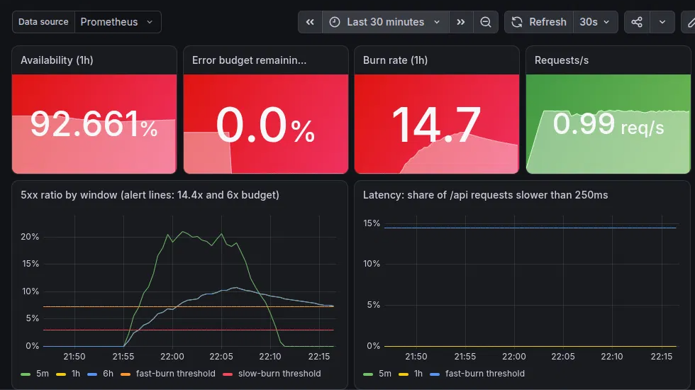

# Runbook: rebuild, verify, teardown

## Before each session
- `source ~/.config/agent-ratings/env` (Linode token, tfstate bucket keys, GoDaddy PAT; not in repo)
- Your public IP must be in `api_allowed_cidrs` (`infra/envs/dev/terraform.tfvars`, gitignored).
  `create-cluster.sh` fails after 2 minutes and prints your IP next to the allowed list if not.

## Rebuild (run one command at a time)
```bash
RECORD=1 ./scripts/create-cluster.sh
export KUBECONFIG=~/.kube/ratings-dev.yaml          # per shell
RECORD=1 ./scripts/install-platform.sh              # also sets the DNS A record via GoDaddy API
RECORD=1 ISSUER=letsencrypt-staging ./scripts/issue-cert.sh
RECORD=1 ./scripts/install-argocd.sh               # Argo CD then deploys everything in apps/
```

## Verify (before teardown)
```bash
GW_IP=$(kubectl -n envoy-gateway-system get gateway eg -o jsonpath='{.status.addresses[0].value}')
curl -k -m 10 --resolve ratings-dev.theblockchainarcade.io:443:$GW_IP -s -o /dev/null -w '%{http_code}\n' https://ratings-dev.theblockchainarcade.io   # 200
P=$(kubectl get pods -n default -o name) && { echo "$P" | grep dnsprobe || echo "probe cleaned up"; }
kubectl -n argocd get application apps -o jsonpath='{.status.sync.status}/{.status.health.status}{"\n"}'   # Synced/Healthy
```
Argo reports HTTPRoute as Healthy without checking it, so the `curl --resolve` 200 is the real end-to-end test.

## Teardown
`RECORD=1 ./scripts/teardown.sh`: destroys the cluster and deletes the DNS record. Idempotent.
If anything fails after create-cluster, still run teardown.
It stops once to confirm deleting Gateways, LoadBalancer Services and PVCs (answer `y`). For an unattended
run: `ASSUME_YES=1 RECORD=1 ./scripts/teardown.sh`.

## Metrics (`results/*.csv`, recorded with RECORD=1)
| Metric | Measures | Observed (as of 2026-10-14) |
|---|---|---|
| cluster_apply | terraform apply | 102-188s, noisy |
| cluster_ready | apply start -> all nodes Ready (the stable number to quote) | **179-208s (n=7)** |
| platform_install | Envoy Gateway + cert-manager + issuers | 55-113s (range only, noisy) |
| argocd_install | Argo CD install -> Application 'apps' Synced/Healthy | 54-57s (n=3) |
| dns_wait | in-cluster probe ready -> authoritative NS serves the Gateway IP | 10-11s (n=2 honest runs) |
| cert_secret | Certificate applied -> Secret signed by the expected issuer | 31-54s (n=6; 54s on 2026-10-14 run 3, cause not investigated) |
| cert_served | ... -> Envoy serves that cert on 443 | 62-85s (n=5 bounded runs) |
| teardown | destroy cluster + delete DNS record | 40-42s |

Excluded as measurement artifacts: cert_served 300 (unbounded probe loop), the first dns_wait 1
(workstation resolver, not the authoritative server), and dns_wait 0 and the later dns_wait 1 (record already published before
the probe started, because install-platform was re-run). See LESSONS.md.

Not in the CSVs (measured by hand on 2026-10-14):
- self-heal: manual scale 2->5 reverted to 2 in <=1s (1-second resolution).
- push->cluster sync: 178s and 155s (n=2). Bounded by Argo's ~3m poll, so this is a config value,
  not pipeline speed.
- ratings-api release 0.1.0 -> 0.1.1 (values.yaml commit): live in 107s. Rollback by `git revert`: 168s.
  n=1 each, same ~3m poll bound.

## GitOps (Argo CD owns `apps/`)
- `platform/argocd/apps-application.yaml`: path `apps/`, recurse, automated sync, prune, selfHeal.
  Public repo, so no repo credentials.
- To change an app: edit under `apps/`, **commit by path** (`git commit apps/... -m ...`), push.
  Expect it on the cluster within ~3m.
- Proof of deploy = `kubectl -n argocd get application apps -o jsonpath='{.status.sync.revision}'`
  equals `git rev-parse HEAD`. The replica count alone is not proof.
- Anything deleted from `apps/` is pruned. Any manual `kubectl` change to an Argo-owned object is reverted.
- UI (not exposed): `kubectl -n argocd port-forward svc/argocd-server 8080:443`, user `admin`, password in
  secret `argocd-initial-admin-secret`.

## ratings-api release flow
1. Change code under `services/ratings-api/`, commit by path, push. CI runs tests and builds the image,
   but does not push it.
2. Release: `git checkout main && git pull && git log --oneline -1` (confirm the commit you mean), then
   `git tag ratings-api-vX.Y.Z && git push origin ratings-api-vX.Y.Z`. CI pushes
   `ghcr.io/jphuphilly/agent-ratings/ratings-api:X.Y.Z`. Confirm the run: `gh run list --limit 2`.
3. Deploy: set `image.tag: "X.Y.Z"` in `charts/ratings-api/values.yaml`, commit by path, push.
   Argo rolls it out within ~3m.
4. Rollback: `git revert --no-edit <values.yaml commit> && git push`. Git is the deploy log.

The GHCR package is public, so the cluster pulls without credentials. Check a tag is pullable without
logging in (expect 200):
```bash
TOK=$(curl -s "https://ghcr.io/token?scope=repository:jphuphilly/agent-ratings/ratings-api:pull" | python3 -c 'import sys,json;print(json.load(sys.stdin)["token"])')
curl -s -o /dev/null -w '%{http_code}\n' -H "Authorization: Bearer $TOK" -H 'Accept: application/vnd.oci.image.index.v1+json' https://ghcr.io/v2/jphuphilly/agent-ratings/ratings-api/manifests/X.Y.Z
```

Verify:
```bash
curl -sk --resolve ratings-dev.theblockchainarcade.io:443:$GW_IP https://ratings-dev.theblockchainarcade.io/api/version   # {"version":"X.Y.Z"}
curl -sk --resolve ratings-dev.theblockchainarcade.io:443:$GW_IP https://ratings-dev.theblockchainarcade.io/metrics | grep -c '^# HELP'   # 0
```
Only `/api` is routed to ratings-api, so `/metrics` on the public hostname lands on whoami. Prometheus output there means
the route leaked.

## Observability and SLOs
`apps/monitoring.yaml` installs kube-prometheus-stack (Prometheus, Alertmanager, Grafana). The ratings-api
chart adds a ServiceMonitor, SLO rules (`templates/prometheusrule.yaml`), a Grafana dashboard and a small
load generator (~1 req/s) so the SLIs always have data.

| SLO | Target | Error budget | Alerts |
|---|---|---|---|
| Availability: /api requests not 5xx | 99.5% | 0.5% | fast burn 14.4x (1h and 5m, for 2m), slow burn 6x (6h and 30m, for 15m) |
| Latency: /api requests < 250ms | 99% | 1% | fast burn 14.4x (1h and 5m, for 2m) |

Budget is measured over 3d, because Prometheus keeps 3d of data here (not 30d). On a fresh cluster the
window holds only what Prometheus has scraped so far, so a short drill can use the whole budget.

Verify (after install-argocd; monitoring takes a few minutes to become Healthy):
```bash
kubectl -n argocd get applications                       # apps, monitoring, ratings-api: Synced/Healthy
kubectl -n monitoring port-forward svc/kps-prometheus 9090 >/dev/null 2>&1 &
curl -s 'localhost:9090/api/v1/targets?state=active' | python3 -c 'import sys,json; print([t["health"] for t in json.load(sys.stdin)["data"]["activeTargets"] if t["labels"].get("job")=="ratings-api"])'   # ['up', 'up']
curl -s 'localhost:9090/api/v1/query' --data-urlencode 'query=ratings_api:requests:rate5m'                            # ~1 req/s
curl -s 'localhost:9090/api/v1/query' --data-urlencode 'query=ratings_api:sli_errors:ratio_rate5m'                    # 0
```
Grafana: `kubectl -n monitoring port-forward svc/kps-grafana 3000:80`, open localhost:3000, dashboard
"ratings-api SLOs". User `admin`, password: `kubectl -n monitoring get secret kps-grafana -o jsonpath='{.data.admin-password}' | base64 -d`.

SLO drill (proves the fast-burn alert fires, through Git only):
1. Set `faultRate: "0.2"` in `charts/ratings-api/values.yaml`, commit by path, push, then `T=$(date +%s)`.
2. Poll until the alert fires:
   ```bash
   firing() { curl -s localhost:9090/api/v1/alerts | python3 -c 'import sys,json; sys.exit(0 if any(a["labels"]["alertname"]=="RatingsApiErrorBudgetBurnFast" and a["state"]=="firing" for a in json.load(sys.stdin)["data"]["alerts"]) else 1)'; }
   until firing; do sleep 15; done; echo "firing after $(( $(date +%s)-T ))s"
   ```
   Detection time = push -> firing (includes ~3m Argo poll + 2m `for`).
3. Revert the commit and push. Confirm the alert clears and 5m error ratio returns to 0.

Drill results, 2026-10-14 (faultRate 0.2, about 12 minutes of clean traffic before the push):

| Event | Time | Source |
|---|---|---|
| Fault commit pushed (`957020a`) | 21:51:11 | GitHub push timestamp |
| 5m error ratio at ~0.21 | by ~21:55 | Prometheus / Grafana |
| Slow burn (6x) pending | 21:56:37 | Prometheus `activeAt` |
| Fast burn (14.4x) pending | 22:00:37 | Prometheus `activeAt` |
| **Fast burn firing** | ~22:02:37, **~686s after push** (polling loop: 695s) | `activeAt` + 2m `for` |
| Revert pushed (`fd02ce6`) | 22:04:17 | git |
| **Fast burn cleared** | ~22:10:06, **349s after revert** | polling loop |
| Slow burn firing | ~22:11:37, after the service had recovered | `activeAt` + 15m `for` |

Expected behaviour seen in the drill: the 1h burn rate stayed at 14.7 after recovery, but the fast alert
cleared because the 5m window had dropped to 0. The slow alert fired late and resolves as its 30m window
drains. See LESSONS.md.


## Gotchas
- The workstation's DNS is proxied (ChromeOS resolver at 100.115.92.193) and caches NXDOMAIN.
  Never verify with local `dig` or by name: use `--resolve`. DNS checks run from inside the cluster.
- `ISSUER` takes the full name (`letsencrypt-staging` / `letsencrypt-prod`). Let's Encrypt prod
  allows 5 certs/week, so staging is the default.
- Helm chart pulls from Docker Hub can fail with `dial tcp [2600:...]:443: network is unreachable`: the
  workstation tried IPv6 and has no IPv6 route. It was intermittent; a plain re-run of the script worked.
  If it repeats: `sudo sysctl -w net.ipv6.conf.all.disable_ipv6=1` (resets on container restart).
- CI fails on any IPv4 address in files or in new commit messages (`.gitleaks.toml`). If you need an
  example address in docs, use a reserved documentation range (192.0.2.x, 198.51.100.x, 203.0.113.x).
- Every new terminal tab needs `source ~/.config/agent-ratings/env` and
  `export KUBECONFIG=~/.kube/ratings-dev.yaml`. Without it, kubectl falls back to `localhost:8080`.
  Port-forwards (`localhost:9090`) work from any tab.
- Ctrl-Z suspends a command; it does not stop it. Use Ctrl-C to cancel. Before teardown, `jobs` in each tab
  should print nothing (kill leftover port-forwards with `kill %1 %2 %3`).
- Read Prometheus API output by parsing the JSON (`python3 -c 'import json...'`), not with `grep -A1`:
  the value sits on a different line from the timestamp.
- Scripts append to tracked `results/*.csv` when RECORD=1. Commit by path, never `git commit -am`,
  or those rows end up in unrelated commits.
